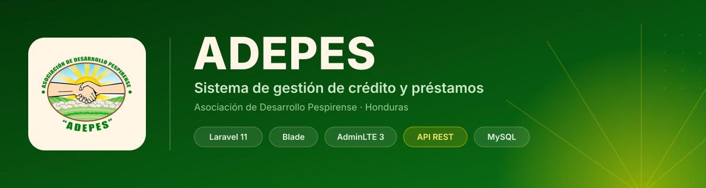
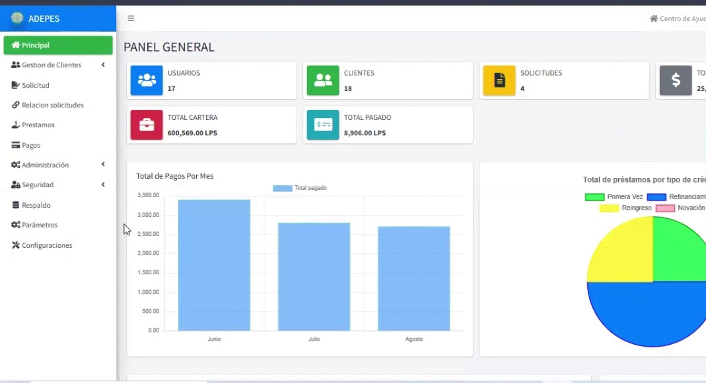
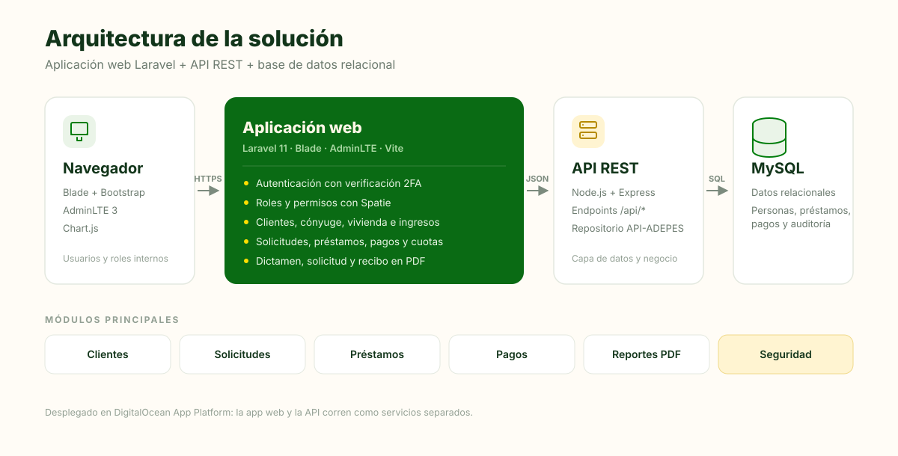

<div align="center">
  
</div>

<div align="center">
  
  
  
  
  
</div>

<br>

# ADEPES

Sistema de gestión para la **Asociación de Desarrollo Pespirense (ADEPES)**, una asociación de desarrollo hondureña con un programa de crédito. Cubre el ciclo completo de un préstamo: desde el expediente del cliente y la solicitud, hasta el dictamen, la tabla de amortización, los pagos y el recibo final.

La aplicación está construida en **Laravel 11** con una interfaz administrativa en **Blade + AdminLTE**, y consume una **API REST en Node.js/Express** que centraliza la información de personas, préstamos y pagos.

---

## El problema que resuelve

Gestionar créditos con hojas de cálculo implica duplicar datos, perder el historial de cada socio y calcular mal las cuotas. ADEPES concentra en un solo sistema:

- El **expediente completo** de cada cliente (datos personales, cónyuge, vivienda, ingresos, referencias y teléfonos).
- El **flujo de aprobación** de solicitudes, con dictamen y tabla de amortización.
- El **control de cartera**: préstamos otorgados, cuotas, pagos al día y pagos retrasados.
- La **trazabilidad** de quién hizo qué, con roles, permisos y bitácora de auditoría.

---

## Funcionalidades

| Módulo | Descripción |
| --- | --- |
| **Panel general** | Indicadores de usuarios, clientes, solicitudes aprobadas, total prestado, cartera y total pagado. Gráficas de pagos y montos por mes, estado de solicitudes y alertas de pagos de la semana y retrasados. |
| **Gestión de clientes** | Expediente del socio: datos personales, cónyuge, vivienda, información laboral, estado de ingresos, referencias familiares y teléfonos. |
| **Solicitudes** | Registro y seguimiento de solicitudes de préstamo, cálculo de la tabla de amortización y generación del dictamen en PDF. |
| **Préstamos** | Aprobación, estado y control de los préstamos otorgados. |
| **Pagos** | Registro de cuotas, consulta de pagos por solicitud y emisión de recibos en PDF. |
| **Reportes** | Documentos PDF de solicitud, dictamen, recibo y relación de solicitudes. |
| **Seguridad** | Administración de usuarios, roles y permisos, autenticación en dos pasos (2FA) y bitácora de acciones. |
| **Configuración** | Parámetros del sistema, ingresos, egresos y catálogos de apoyo. |

### Flujo de un crédito

```text
Alta del cliente  →  Solicitud de préstamo  →  Dictamen + tabla de amortización (PDF)
        ↓
Aprobación y registro del préstamo  →  Pagos y cuotas  →  Recibo (PDF) + bitácora
```

---

<!--
## Capturas

Cuando las imágenes estén en `docs/screenshots/`, activa esta sección:

<p align="center">
  
</p>

| Clientes | Solicitudes | Pagos |
| --- | --- | --- |
|  |  |  |
-->

## Arquitectura

<div align="center">
  
</div>

La solución está separada en dos servicios:

1. **Aplicación web (este repositorio).** Laravel 11 renderiza las vistas con Blade y AdminLTE. Administra la sesión, los usuarios, los roles y la bitácora en su propia base de datos, y genera los documentos PDF con DomPDF.
2. **API REST ([API-ADEPES](https://github.com/chris2555/API-ADEPES)).** Node.js + Express expone los endpoints `/api/*` que la aplicación web consume con el cliente HTTP de Laravel para personas, cónyuges, viviendas, ingresos, solicitudes, préstamos y pagos.

> En producción ambos servicios se despliegan por separado en DigitalOcean App Platform y comparten una base de datos MySQL.

---

## Stack tecnológico

| Capa | Tecnologías |
| --- | --- |
| **Backend** | PHP 8.2+, Laravel 11 |
| **Frontend** | Blade, AdminLTE 3, Bootstrap 5, Vite, SCSS |
| **Autenticación** | Laravel Breeze / Laravel UI, verificación de correo y 2FA |
| **Permisos** | `spatie/laravel-permission` |
| **PDF** | `barryvdh/laravel-dompdf` |
| **Gráficas** | Chart.js |
| **Base de datos** | MySQL en producción · SQLite para desarrollo local |
| **API** | Node.js + Express ([API-ADEPES](https://github.com/chris2555/API-ADEPES)) |

---

## Requisitos

- PHP **8.2** o superior con las extensiones habituales de Laravel (`mbstring`, `openssl`, `pdo`, `xml`, `ctype`, `json`, `bcmath`, `fileinfo`)
- [Composer](https://getcomposer.org/) 2
- [Node.js](https://nodejs.org/) 18+ y npm
- MySQL 8 / MariaDB (o SQLite si prefieres no instalar un servidor)
- La API [API-ADEPES](https://github.com/chris2555/API-ADEPES) en ejecución para los módulos de negocio

---

## Instalación

```bash
# 1. Clona el repositorio
git clone -b christian https://github.com/chris2555/ADEPES.git
cd ADEPES

# 2. Instala dependencias
composer install
npm install

# 3. Configura el entorno
cp .env.example .env
php artisan key:generate

# 4. Configura tu base de datos en .env y crea las tablas
php artisan migrate

# 5. Compila los assets y levanta el servidor
npm run build          # o `npm run dev` durante el desarrollo
php artisan storage:link
php artisan serve
```

Abre [http://localhost:8000](http://localhost:8000).

### Usuario de prueba (opcional)

El seeder crea un usuario de demostración y los permisos base del sistema:

```bash
php artisan migrate --seed
```

```text
Correo:     test@example.com
Contraseña: password
```

> Los roles se asignan después desde **Seguridad → Roles**. El seeder no crea roles por sí solo, así que en una instalación nueva hay que darlos de alta antes de usar los módulos protegidos.

---

## Variables de entorno

Las variables principales de `.env`:

| Variable | Uso |
| --- | --- |
| `APP_NAME` | Nombre visible de la aplicación. |
| `APP_URL` | URL base, necesaria para correos y enlaces generados. |
| `DB_CONNECTION` | `mysql` en producción, `sqlite` para desarrollo rápido. |
| `DB_HOST`, `DB_PORT`, `DB_DATABASE`, `DB_USERNAME`, `DB_PASSWORD` | Conexión a la base de datos. |
| `SESSION_DRIVER` | `database` (por defecto) o `file`. |
| `MAIL_*` | Envío de correos de verificación y recuperación de contraseña. |
| `QUEUE_CONNECTION` | Cola de trabajos; `database` por defecto. |

> **Nota:** la URL de la API está definida directamente en los controladores. Para trabajar en local, apunta esas llamadas a tu instancia de API-ADEPES. Centralizarla en `config/services.php` y una variable de entorno es una de las mejoras pendientes (ver [Roadmap](#roadmap)).

---

## Estructura del proyecto

```text
ADEPES/
├── app/
│   ├── Http/
│   │   ├── Controllers/        # Módulos de negocio y autenticación
│   │   ├── Middleware/         # Bitácora y verificación 2FA
│   │   └── Requests/           # Validación de formularios
│   └── Models/                 # User, Persona, SolicitudPrestamo, Pago, Cuota…
├── config/
│   └── adminlte.php            # Menú lateral, tema y configuración de AdminLTE
├── database/
│   ├── migrations/             # Usuarios, sesiones, permisos, bitácora, configuración
│   └── seeders/                # Usuario demo y permisos base
├── docs/                       # Banner y diagrama de arquitectura
├── public/
│   └── img/                    # Logotipos institucionales
├── resources/
│   ├── views/                  # Vistas Blade por módulo
│   ├── css/ · js/              # Assets de Vite
│   └── sass/
├── routes/
│   ├── web.php                 # Rutas de la aplicación
│   └── auth.php                # Rutas de autenticación
└── composer.json · package.json
```

---

## Seguridad

- **Roles y permisos** con `spatie/laravel-permission`; el menú y las rutas se filtran por permisos como `ver-seguridad`, `ver-tecnico` o `Ver-reportes`.
- **Autenticación en dos pasos (2FA)** con middleware propio (`Verify2FAMiddleware`).
- **Bitácora de auditoría** que registra las acciones sobre los módulos (`BitacoraMiddleware`).
- **Verificación de correo** y recuperación de contraseña con enlaces firmados.
- Los documentos sensibles (dictamen, solicitud, recibo) se generan al vuelo y no se almacenan en disco.

---

## Roadmap

- [ ] Centralizar la URL de la API en `config/services.php` + `.env`.
- [ ] Completar los seeders de roles y permisos para una instalación lista para usar.
- [ ] Cubrir los flujos críticos (solicitud, aprobación, pago) con pruebas Pest.
- [ ] Añadir Docker / Laravel Sail para levantar el entorno con un comando.
- [ ] Capturas de pantalla y demo pública.

---

## Créditos

Desarrollado para la **Asociación de Desarrollo Pespirense (ADEPES)**. Mantenido por [@chris2555](https://github.com/chris2555).

¿Dudas o mejoras? Abre un [issue](https://github.com/chris2555/ADEPES/issues).
